<div align="center">
  
</div>

<div align="center">

**Backend engineering for systems where a retry must never become a second transaction.**

[](https://www.linkedin.com/in/YOUR_LINKEDIN_USERNAME/)
[](mailto:YOUR_EMAIL@example.com)


</div>

### `> whoami`

I'm a **Senior Backend Developer** working on reliable financial software, with experience in **banking, payments, card systems, money transfers, onboarding and open banking**.

I work primarily with **Java / Spring Boot**, and bring hands-on **C# / .NET** experience to cross-stack engineering challenges. I care about correct transaction lifecycles, clear service boundaries, safe retries, consistency and maintainable APIs.

### `> system.stack`

<div align="center">
  
</div>

### `> engineering.principles`

| Principle | What it means in practice |
| :-- | :-- |
| **Idempotency** | A retried payment request doesn't create a duplicate transaction. |
| **Consistency** | Balance, ledger and status changes are designed around transactional boundaries. |
| **Resilience** | Timeouts, retries, failures and recovery paths are first-class design concerns. |
| **Observability** | Correlation IDs and useful logs help explain a transaction end to end. |
| **Maintainability** | Clear domain models, testable code and intentional abstractions. |

### `> current.focus`

```text
BANKING     ████████████████████  Card systems · Money transfers · Open banking
BACKEND     ████████████████████  Java / Spring Boot · C# / .NET
DISTRIBUTED ████████████████████  Kafka · Microservices · Event-driven design
DATA        ████████████████████  PostgreSQL · SQL · Transaction integrity
```

### `> contribution.telemetry`

<div align="center">
  
</div>

<div align="center">
  <sub>Design for failure. Build for recovery. Never double-charge.</sub>
</div>
